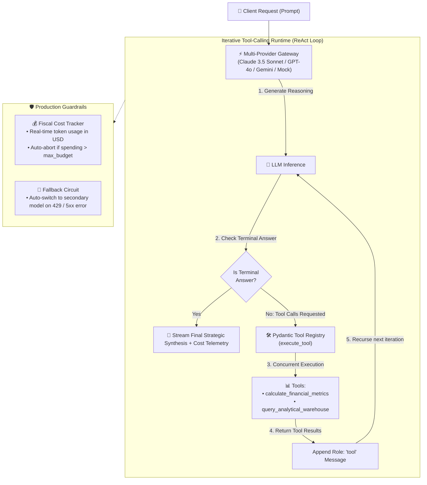

# 🤖 Agentic AI Runtime

[](https://python.org/)
[](https://fastapi.tiangolo.com/)
[](https://docs.pydantic.dev/)
[](https://pytest.org/)
[](https://github.com/starl1n/agentic-ai-runtime)
[](LICENSE)

> **A production-grade, resilient autonomous AI agent runtime** featuring iterative tool-calling loops (ReAct), multi-provider fallback orchestration (Claude ↔ GPT-4o ↔ Gemini), real-time Server-Sent Events (SSE) streaming, and fiscal budget guardrails.

---

## 📌 What is this repository?

### Executive Summary
Most public AI projects are simplistic single-prompt wrappers around LLM chat endpoints. In production, enterprise AI requires **autonomous reasoning loops, type-safe tool execution, multi-model failover, and strict fiscal budget guardrails**.

**Agentic AI Runtime** is an open-source reference implementation engineered to demonstrate how production-grade AI agents should be constructed. It allows autonomous agents to dynamically query analytical warehouses, execute financial formulas, fail over to alternate model providers during outages, and stream their reasoning step-by-step to frontend clients.

### Who is this for?
- **AI Engineers & Architects:** Looking for clean, non-framework-bloated patterns (no fragile mega-framework abstractions) for autonomous tool calling.
- **Engineering Leaders & CTOs:** Reviewing telemetry, cost controls, and failover resilience against LLM provider outages.
- **Backend Developers:** Exploring how to build type-safe, validated tool registries with Pydantic v2 and FastAPI.

---

## 🏛️ Autonomous Agent Loop Architecture



---

## 💡 Key Architectural Pillars

### 1. 🔄 Multi-Provider Resilience & Graceful Fallback
- **Problem:** LLM APIs suffer frequent rate limits (HTTP 429), regional outages (HTTP 500/503), or degraded latency.
- **Runtime Solution:** The `MultiProviderGateway` manages a prioritized fallback chain. If the primary provider fails, it instantly fails over to secondary models without breaking client requests:
  ```python
  gateway = MultiProviderGateway(providers=[primary_anthropic, secondary_openai, fallback_mock])
  ```

### 2. 🛡️ Type-Safe Tool Schemas with Pydantic v2
- Tool arguments are strictly validated before execution. If an LLM hallucinates an invalid parameter type, Pydantic catches it immediately, returning an actionable error message back to the LLM to self-correct in the next loop.

### 3. 💰 Fiscal Guardrails & Token Telemetry
- Every prompt and completion token is logged in USD based on live model pricing catalogues ($/1M tokens).
- A `BudgetExceededException` automatically terminates runaway agent loops if financial spend exceeds the allocated task budget (e.g., `$0.50 USD`).

### 4. ⚡ Real-Time Event Streaming (SSE)
- Streams granular step-by-step telemetry to client interfaces:
  - `iteration_start` (Current reasoning cycle)
  - `tool_calling` (Tool name and JSON arguments)
  - `tool_result` (Sanitized output from backend tools)
  - `final_answer` (Synthesized executive response with token telemetry)

---

## 📂 Repository Structure

```
agentic-ai-runtime/
├── src/
│   ├── agents/
│   │   └── orchestrator.py    # Autonomous tool loop & SSE event stream generator
│   ├── providers/
│   │   └── base.py            # Base provider, Mock simulator, MultiProviderGateway
│   ├── tools/
│   │   ├── base.py            # BaseTool class with automatic Pydantic schema inference
│   │   └── registry.py        # ToolRegistry & production financial/analytical tools
│   ├── telemetry/
│   │   └── cost_tracker.py    # Real-time token cost tracker ($/1M tokens) & budget guardrails
│   └── api/
│       └── server.py          # FastAPI endpoints & Interactive Web Playground
├── tests/
│   └── test_agent_runtime.py  # Pytest suite (Tool loop, Fallback, Guardrails, Security)
├── Dockerfile                 # Production container definition
├── pyproject.toml             # Modern Python packaging configuration
└── requirements.txt           # Pinned production dependencies
```

---

## 🚀 Quickstart & Interactive Playground

### Option 1: Running Locally (Fastest)
```bash
# 1. Clone repository
git clone https://github.com/starl1n/agentic-ai-runtime.git
cd agentic-ai-runtime

# 2. Create virtual environment & install dependencies
python3 -m venv .venv
source .venv/bin/activate
pip install -r requirements.txt

# 3. Start the API server
uvicorn src.api.server:app --reload --port 8000
```
- **Open the Interactive Web Playground:** [http://localhost:8000](http://localhost:8000)
- **Interactive Swagger Docs:** [http://localhost:8000/docs](http://localhost:8000/docs)

---

### Option 2: Running with Docker
```bash
docker build -t agentic-ai-runtime .
docker run -p 8000:8000 agentic-ai-runtime
```

---

## 🧪 Automated Test Verification

Run the test suite using `pytest`:
```bash
.venv/bin/pytest tests/ -v
```

### Verified Test Matrix:
- ✅ `test_tool_calling_loop_executes_successfully`: Verifies multi-step ReAct execution and terminal answer synthesis.
- ✅ `test_multi_provider_fallback_on_failure`: Verifies failover to secondary provider when the primary model encounters network/rate limits.
- ✅ `test_budget_exceeded_guardrail`: Verifies automatic loop abortion when cost budget is exceeded.
- ✅ `test_sql_warehouse_mutation_blocking`: Verifies security policy blocking destructive queries (`DROP`, `DELETE`, etc.).

---

## 📄 License
This project is licensed under the MIT License - see the [LICENSE](LICENSE) file for details.
